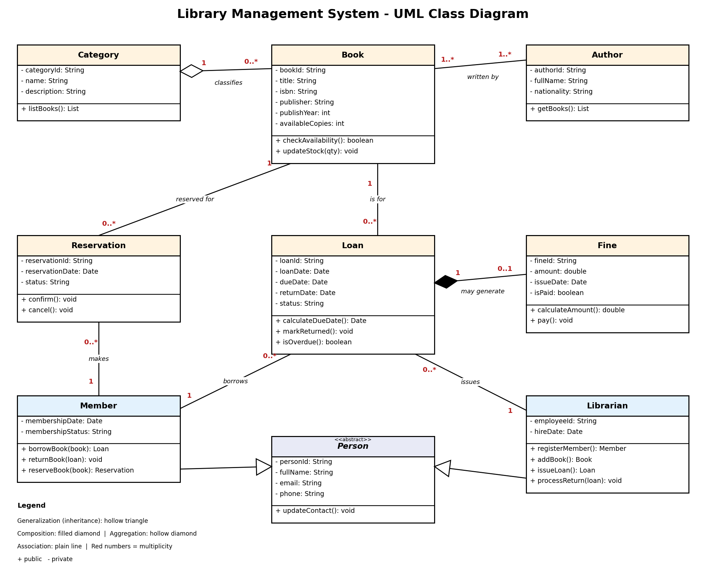

# Library Management System - UML Class Diagram

**Course:** UML Class Diagram Modelling Assignment - Kigali Independent University (ULK)
**Instructor:** Eric Maniraguha
**Group members:**
-  abdalla mohmed abdalla - Student ID: [___202511866_____]
- [Ahmed makawi Abdallah  - Student ID: [_202512664_______]

## Business idea
A school or community library needs an information system to register members, manage books, record loans and reservations, and calculate fines for late returns.

## Problem statement
Manual paper registers make it hard to know which books are available, who borrowed them, and which returns are late.

## Scope
**Included:** member management, book catalogue (books, authors, categories), loans and returns, reservations, fines, librarian operations.
**Excluded:** online payments, e-books, inter-library loans, supplier/accounting modules, a working application (design only).

## Main classes
| Class | Role |
|202511866|202512644|
| Person (abstract) | Common data for users |
| Member | Borrows, returns and reserves books |
| Librarian | Registers members, adds books, issues loans |
| Book | Catalogue item with stock |
| Author | Writer of books |
| Category | Groups books |
| Loan | Member borrows a book |
| Reservation | Member holds an unavailable book |
| Fine | Penalty for a late loan (composition with Loan) |

## Key relationships
- Person <|-- Member, Librarian (generalization)
- Member 1 --- 0..* Loan; Member 1 --- 0..* Reservation
- Librarian 1 --- 0..* Loan
- Loan 0..* --- 1 Book; Reservation 0..* --- 1 Book
- Book 1..* --- 1..* Author
- Category 1 o--- 0..* Book (aggregation)
- Loan 1 *--- 0..1 Fine (composition)

## Repository structure
```
uml-class-diagram-assignment/
├── README.md
├── documentation/
│   ├── report_1_project_description.pdf
│   └── report_2_uml_class_diagram.pdf
└── diagrams/
    ├── uml_class_diagram.drawio
    └── uml_class_diagram.png
```


